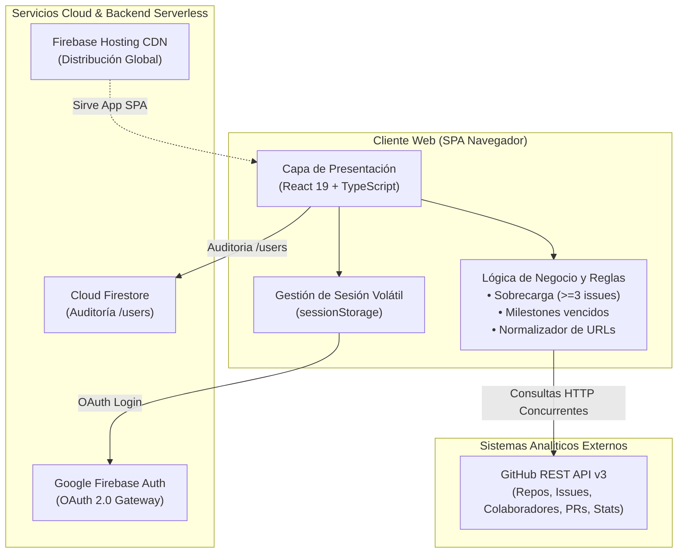

# Monitor de Métricas de Proyectos en Github

> **Sistema Inteligente de Analítica de Repositorios GitHub, Gestión de Equipos y Toma de Decisiones Empresariales**  
> Proyecto desarrollado para el curso de **Inteligencia de Negocios (SI-885)** — Semestre 2026-II  
> **Universidad Privada de Tacna** | Facultad de Ingeniería | Escuela Profesional de Ingeniería de Sistemas

---

## Descripción del Proyecto

**Monitor de Métricas BI** (*DevMetrics BI Solutions*) es una plataforma web analítica de observabilidad de software diseñada para líderes técnicos, docentes evaluadores y equipos de desarrollo. Permite supervisar en tiempo real el progreso de repositorios de software en GitHub, optimizar la asignación de recursos y consolidar indicadores estratégicos mediante:

- **Analítica de repositorios:** Extracción en tiempo real de KPIs clave (commits, estrellas, bifurcaciones e incidencias abiertas).
- **Control de carga laboral:** Detección algorítmica de sobrecarga laboral en desarrolladores ($\ge 3$ incidencias abiertas asignadas) y coeficiente de Gini para equidad.
- **Seguimiento de cronogramas:** Monitoreo porcentual de hitos (*milestones*) con semáforo de riesgo y alertas proactivas ante fechas límite vencidas.
- **Inteligencia de negocios unificada:** Motor propio de analítica con Health Score integral (0-100), benchmarking comparativo entre repositorios y visualizaciones interactivas con Recharts.

---

## Stack Tecnológico

| Capa / Dominio | Tecnología | Descripción |
| :--- | :--- | :--- |
| **Frontend SPA** | [React 19](https://react.dev/) + [TypeScript](https://www.typescriptlang.org/) | Interfaz declarativa, tipada y modular de alto rendimiento. |
| **Visualización Analítica**| [Recharts](https://recharts.org/) | Gráficos reactivos interactivos (Area, Bar, Radar, Pie, Line). |
| **Build & Tooling** | [Vite](https://vite.dev/) + [Oxlint](https://oxc.rs/) | Empaquetado ultrarrápido y análisis estático de código. |
| **Iconografía e Interfaz**| [Lucide React](https://lucide.dev/) + CSS Moderno | Componentes visuales responsivos con paleta ejecutiva oscura. |
| **Autenticación** | [Firebase Authentication v12](https://firebase.google.com/) | Autenticación federada mediante GitHub OAuth 2.0 con tokens de sesión volátiles. |
| **Persistencia Serverless** | [Cloud Firestore](https://firebase.google.com/docs/firestore) | Base de datos NoSQL serverless para auditoría y perfiles de usuario (`/users/{uid}`). |
| **Hosting & CDN** | [Firebase Hosting](https://firebase.google.com/docs/hosting) | Distribución global de la SPA con TLS 1.3 automático y alta disponibilidad. |
| **Ingesta de Datos** | [GitHub REST API v3](https://docs.github.com/en/rest) | Endpoints `/repos`, `/issues`, `/contributors`, `/stats/*`, `/pulls` y `/milestones` (5,000 req/h). |

---

## Arquitectura del Sistema

La solución adopta una arquitectura desacoplada orientada a servicios serverless, formulada bajo el **Modelo de Vistas 4+1 de Philippe Kruchten**:



### Capas Principales:
1. **Presentación (UI):** Single Page Application estructurada en componentes modulares (Dashboard, Comparador, Equipo, Cronograma, Pull Requests y Configuración).
2. **Lógica de Negocio:** Motores analíticos propios (`/utils/metrics.ts`) que procesan datos de GitHub y generan Health Score, detección de sobrecarga, Gini y burndown.
3. **Persistencia & Identidad:** Almacenamiento seguro no destructivo de perfiles en Cloud Firestore y resguardo efímero de credenciales GitHub OAuth.

---

## Estructura del Repositorio

```text
├── .firebaserc                     # Configuración del proyecto de Firebase
├── firebase.json                   # Reglas de Hosting y reescritura de rutas SPA
├── README.md                       # Documentación principal del repositorio
├── docs/                           # Documentación técnica de estándares EPIS
│   ├── FD01-Informe-Factibilidad.md
│   ├── FD02-Informe-Vision.md
│   ├── FD03-Informe-Especificacion-Requerimientos.md
│   └── FD04-EPIS-Informe Arquitectura de Software.md
├── diagrams/                       # Diagramas de modelado (PlantUML / Mermaid)
├── media/                          # Recursos gráficos institucionales (Logos)
└── monitor-app/                    # Código fuente de la aplicación web (SPA)
    ├── package.json                # Dependencias y scripts de compilación
    ├── vite.config.ts              # Configuración de Vite y optimización
    ├── tsconfig.json               # Configuración del compilador TypeScript
    ├── public/                     # Recursos estáticos de distribución
    └── src/
        ├── firebase.ts             # Configuración e instanciación de Firebase SDK
        ├── index.css               # Sistema de diseño, tokens y variables CSS
        ├── main.tsx                # Punto de entrada de la aplicación React
        └── App.tsx                 # Vistas, componentes y orquestador del estado
```

---

## Puesta en Marcha (Desarrollo Local)

### Prerrequisitos
- **Node.js** v20 o superior
- **npm** v10 o superior

### Instrucciones

1. **Clonar el repositorio:**
   ```bash
   git clone https://github.com/UPT-FAING-EPIS/si885-2026-ii-si885-2026-ii-proyecto-group-4.git
   cd si885-2026-ii-si885-2026-ii-proyecto-group-4
   ```

2. **Acceder a la aplicación e instalar dependencias:**
   ```bash
   cd monitor-app
   npm install
   ```

3. **Iniciar el servidor en modo desarrollo:**
   ```bash
   npm run dev
   ```
   *La aplicación estará accesible en `http://localhost:5173`.*

4. **Compilar para producción:**
   ```bash
   npm run build
   ```

---

## Equipo de Desarrollo (Grupo N° 4)

| Integrante | Código | Rol / Responsabilidad |
| :--- | :---: | :--- |
| **Colque Quispe, Rodrigo Sídney** | 2023077078 | Arquitectura, Lógica de Negocio y Conectores Cloud |
| **Ramos Atahuachi, Fabricio Farid Edmilson** | 2023076798 | Frontend SPA, Modelado Arquitectónico y UI/UX |
| **Choqueña Choque, Mauricio Adrian** | 2023076799 | Integración Analítica, Pruebas y Métricas de Rendimiento |

- **Docente:** Mag. Patrick José Cuadros Quiroga  
- **Institución:** Universidad Privada de Tacna (UPT)  
- **Año:** 2026
